# @parallang/aesthetic

The visual direction for ParaLLang: PlayStation 1-style 3D, demonstrated on the lore's dead branch, where temple ruins
are strangled by roots (the strings that pulled two worlds together). The package holds the look and three levels:
**Angkor Wat**, **Ta Prohm**, the temple the jungle kept, and **The Kiln**, Ta Prohm burnt. It imports nothing from the game code in `client/`,
`server/` or `mobile/`. Since round 115 it is an npm workspace of the repository, and the web client's dungeon crawl
renders its Ta Prohm level (`client/src/scene/levelView.js`).

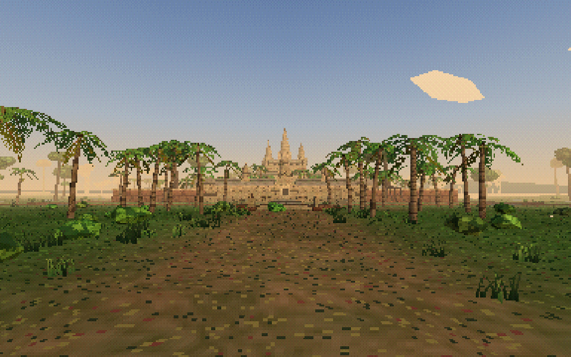

| | |
|---|---|
| 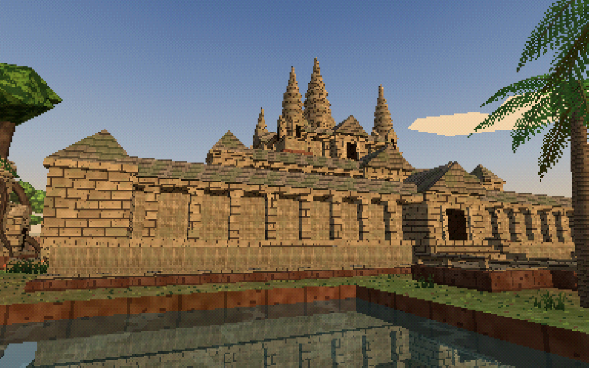 | 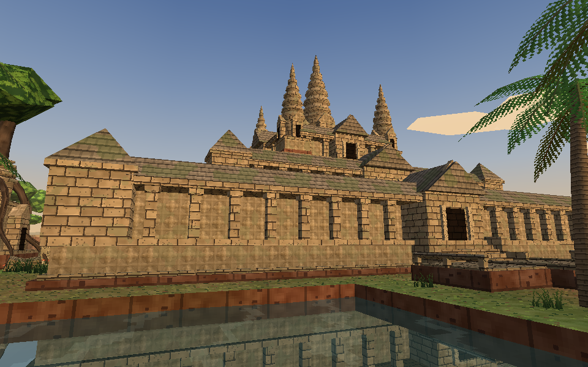 |
| Reflecting pool, PS1 look | Same view, PS1 look off |
| 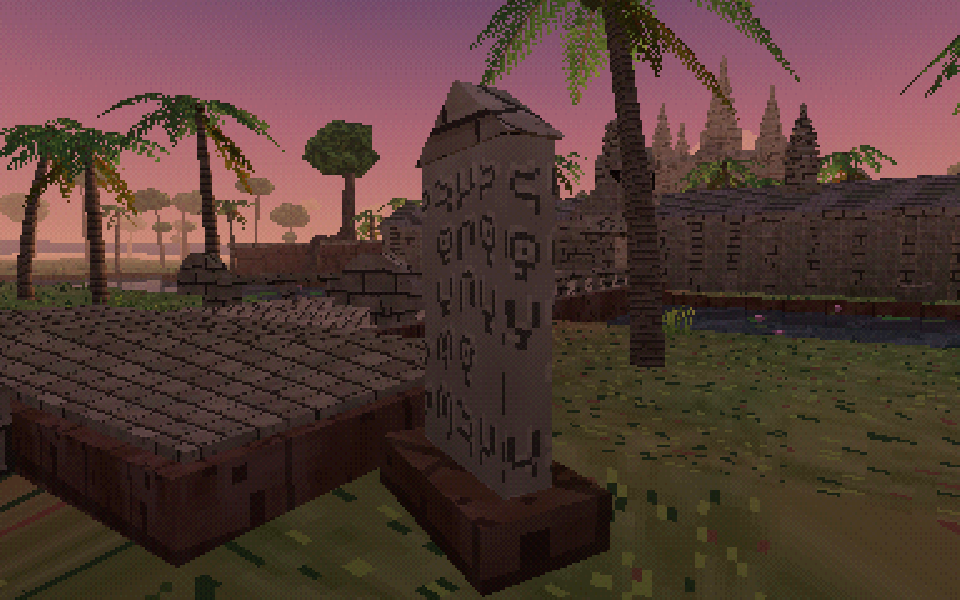 | 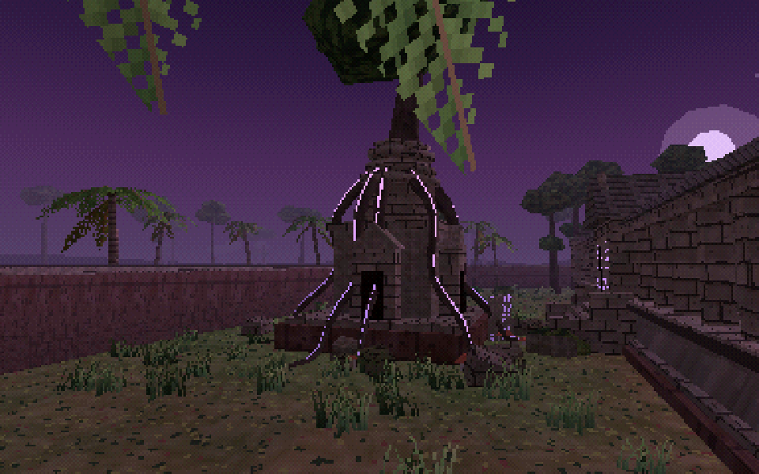 |
| An inscribed stele at dawn | The dead branch: roots glow with corruption |

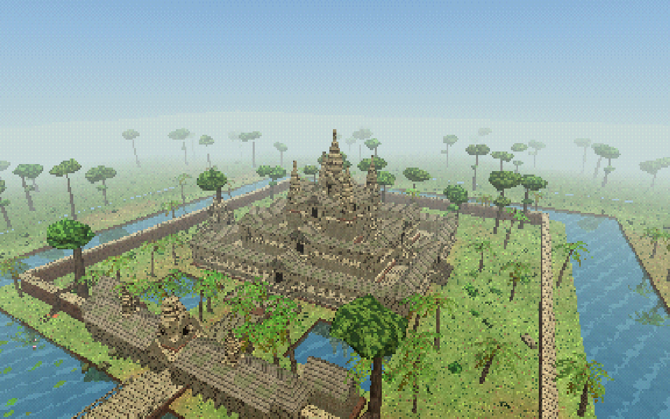

### Ta Prohm

A flat, east-facing monastery temple with galleried enclosures, left to the jungle. Giant thitpok trees stand on the
galleries and pour their roots over walls and doorways, a strangler fig grips a corner tower, collapsed galleries lie in
heaps of fallen blocks, and light comes down in shafts through the canopy. The east gopura carries a Bayon-style face
tower; gallery walls carry devatas in niches.

| | |
|---|---|
| 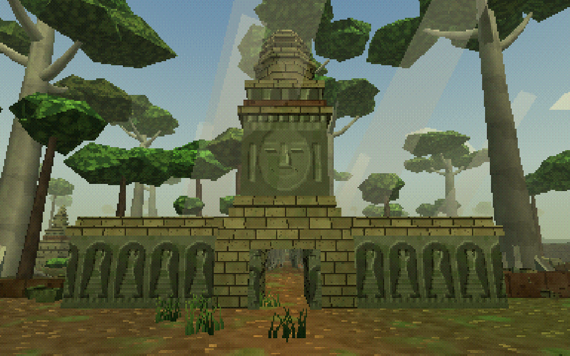 | 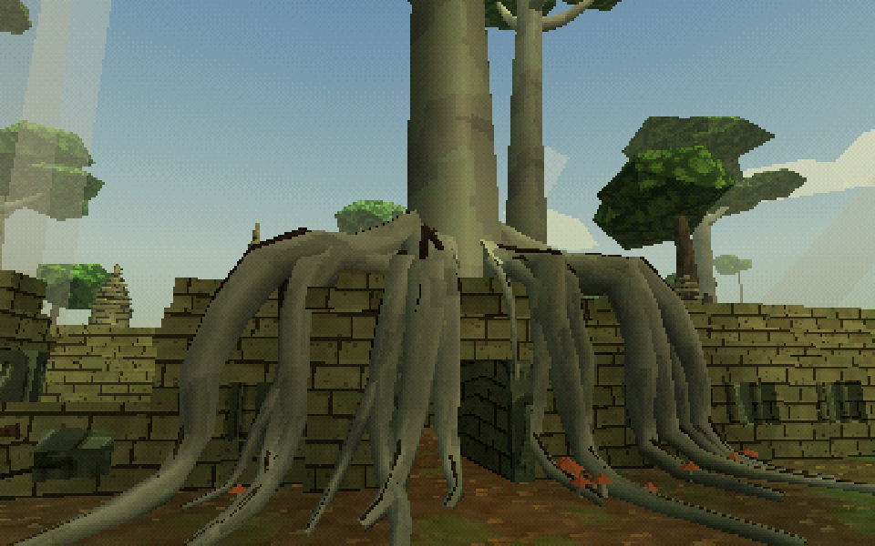 |
| The face-tower gopura, jungle morning | The gate tree: roots pour over the pavilion and frame its door |
| 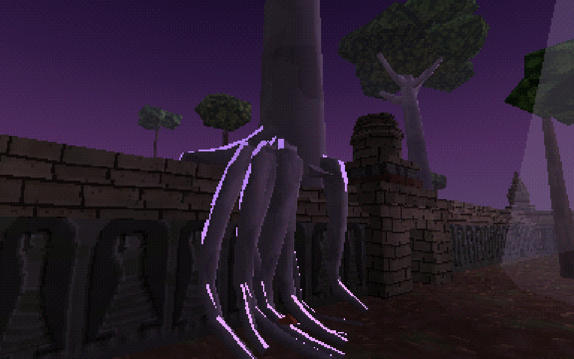 | 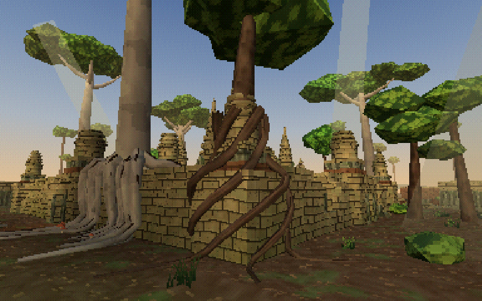 |
| A thitpok astride a gallery, with the strings lit | A strangler fig gripping a corner tower |

### The Kiln

Ta Prohm's plan again, burnt (round 132). It is built by the same builder with the same random sequence, so every
wall, collapsed bay and root stands where it does in Ta Prohm, and it uses the same sixteen textures: no new texture
and no new model. The theme changes the rest: soot where the moss was, three bare branches where each canopy blob
was, low flames for grass tufts, columns of lit smoke for light shafts, a floor of dark rock with hot patches, a
moat of lava round the outer wall (the water texture, unlit and tinted) and embers that rise over the courts. The
stone, the floor and the bark glow in the dark parts of their textures (joints, grooves, cracks), strongest at the
ground. The preset `ember` lights the scene from the floor: more ambient light from the ground than from the sky.

| | |
|---|---|
| 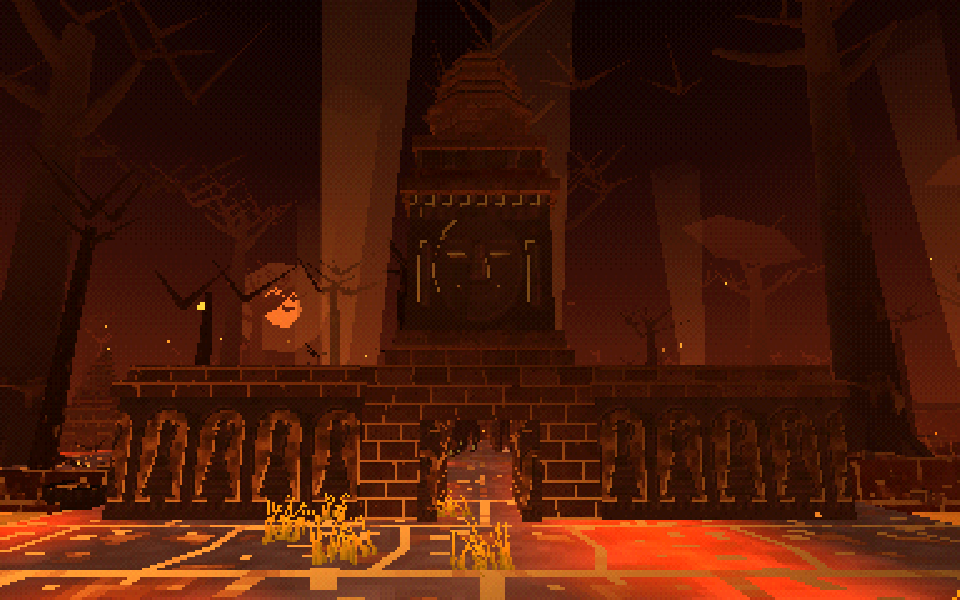 | 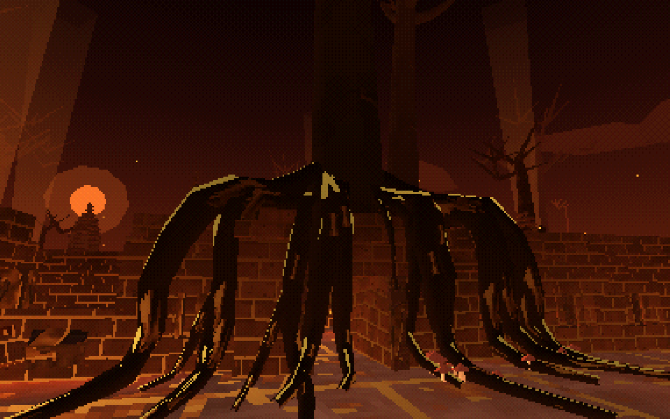 |
| The face-tower gopura from the avenue | The gate tree: charred roots with ember veins |
| 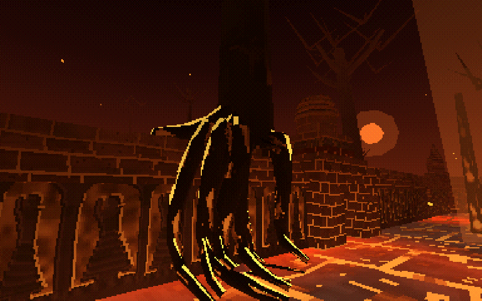 | 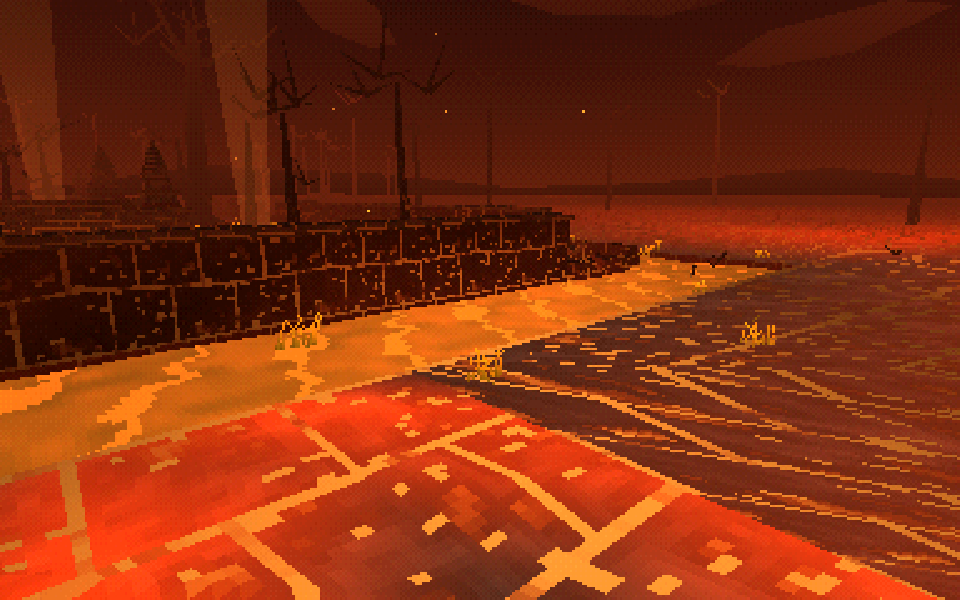 |
| A thitpok astride a gallery, the sun behind it | The lava moat outside the outer wall |

## Why three.js

[three.js](https://threejs.org) is plain JavaScript, so it runs in the browser and, through `expo-gl`, in the
Expo iPhone app. The scene, the PS1 shaders and the camera rig in `src/` use no DOM; only the hosts (`demo/` for
web, `native/` for Expo) know about canvases and touch input. Textures are generated in code from a seed, so there
are no image assets to load on any platform.

## Run it

```bash
npm install         # at the repository root: aesthetic is a workspace
cd aesthetic
npm run dev        # http://localhost:5180
npm test           # headless checks over the three levels: budget, determinism, VRAM rules, presets, the Kiln's theme, dither table
```

Controls: the panel's Level row switches between Angkor Wat, Ta Prohm and The Kiln. Drag to orbit, wheel or pinch to zoom,
`Space` toggles tour and orbit, `1`–`5` pick the time of day,
`P` toggles the PS1 look, `H` hides the panel. The panel also toggles each effect (jitter, affine, dither,
scanlines), the resolution (240p, 480i, native) and the corruption level.

URL parameters for fixed views: `?scene=taprohm` (or `kiln`), `?preset=dawn`, `?t=0.3&pause=1` (tour position), `?cam=x,y,z,lookX,lookY,lookZ`,
`?orbit=yaw,pitch,distance`, `?ps1=0`, `?corruption=0.7`, `?ui=0`.

Reference shots: `npm run build && npm run preview`, then `node scripts/screenshots.cjs` (needs Playwright with
Chromium) rewrites `docs/shots/`.

## Use it

```js
import { PerspectiveCamera, WebGLRenderer } from 'three';
import { createWorld, createPS1Pipeline, createCameraRig } from '@parallang/aesthetic';

const renderer = new WebGLRenderer({ canvas, antialias: false });
const world = createWorld('taprohm', { seed: 7 }); // or 'angkor', 'kiln'
const camera = new PerspectiveCamera(60, width / height, 0.3, 700);
const pipeline = createPS1Pipeline(renderer, { uniforms: world.uniforms }); // 240 lines, 15-bit, dithered
const rig = createCameraRig(camera, { keyframes: world.tour, target: world.orbitTarget });

renderer.setSize(width, height, false);
pipeline.resize();
function frame(dt) {
  rig.update(dt);
  world.update(dt, camera);
  pipeline.render(world.scene, camera);
}
```

For new levels, follow `src/scene/taprohm.js`: `createWorldKit` gives the shared uniforms, textures and materials,
`MeshBuilder` merges geometry into one draw call per material and paints grime, moss and canopy shade into vertex
colours, and `assembleWorld` adds the sky, presets, corruption and the optional water reflection. Every level returns
the same interface, and `WORLDS` in `src/worlds.js` lists them.

**In the iPhone app.** `native/TempleView.js` is a reference Expo component that renders the same world through
`expo-gl` and maps pan gestures to the camera rig. It is not wired into `mobile/` and has not been run in the iOS
Simulator yet. To try it: `npx expo install expo-gl` and `npm install three@0.186.1` in `mobile/`, then render
`<TempleView scene="taprohm" />`.

**In another engine.** [STYLE.md](STYLE.md) states the look as rules and numbers, and `src/style.js` exports the
same values as data (`PS1_STYLE`).

## Files

| Path | What it holds |
|---|---|
| `src/ps1/shaders.js` | Vertex snapping, affine UVs, Gouraud lighting, depth-cue fog, corruption glow; the 15-bit dither post pass |
| `src/ps1/material.js` | `createPS1Material` and the shared uniforms every material references |
| `src/ps1/pipeline.js` | Low-resolution render target, nearest upscale, dither and quantise |
| `src/ps1/textures.js` | Procedural 32–64 px textures: sandstone, rosette relief, inscriptions, laterite, roof, grass, water, bark, roots, leaves, fronds, grass tufts, thitpok bark, devata niches, the carved face, leaf litter |
| `src/scene/temple.js` | Three tiers with galleries, five lotus-bud prangs, gopura, enclosure, naga causeways, libraries |
| `src/scene/ruins.js` | The Ta Prohm-style shrine, strangler figs with glowing strings, mushrooms, stele, lions, rubble |
| `src/scene/vegetation.js` | Palms, jungle trees, bushes, grass tufts, lily pads and lotus |
| `src/scene/terrain.js`, `layout.js` | Ground grid, moat and pools, banks; the site plan |
| `src/scene/sky.js`, `presets.js` | Gradient sky, sun, clouds, hills; golden hour, dawn, midday haze, jungle morning, the dead branch |
| `src/scene/world.js` | The shared kit, `assembleWorld`, and the Angkor Wat level |
| `src/scene/taprohm.js` | The Ta Prohm level: enclosures, galleries with baluster windows and corbelled vaults, the face-tower gopura, thitpok trees with root cascades, the fig tower, light shafts, rubble. Also The Kiln: the same builder under the ember theme (`createKilnWorld`) |
| `src/worlds.js` | The level registry: `WORLDS`, `createWorld(id)` |
| `src/camera.js` | Tour, orbit and fixed camera modes, fed by any input source |
| `demo/`, `index.html` | Web host |
| `native/TempleView.js` | Expo host (reference, untested) |
