# Round 115 findings

## Question
Can the web client play the Ta Prohm dungeon crawl that round 114 designed: three sites in order, five camera
transitions, the existing dialogue at each site and a victory screen, on a phone and on a desktop?

## Finding
Yes, against a server with a fixture provider. The built client plays all three sites from the title to the victory
screen in headless Chromium at 390×844 and at 1440×900 with no page error, and every suite passes. Nobody has played
it against the live model or on a real phone yet.

## Method
The build started from round 114's Design and `level-wip.patch`. The patch's director, store flow and workspace join
were reviewed and rewritten where they were wrong (below). Tests ran in Slurm jobs on node dada (CPU): the server
and the client's proxy tests bind 127.0.0.1 ports, which the login node must not do. Pure client tests (director,
dungeon file, store, screen) ran on the login node while developing. The playthrough script
(`client/scripts/dungeon-shots.mjs`) served `client/dist` under `/ParaLLang/` by request interception, ran an
in-process server with a fixture provider behind a random token, and drove the real interface: Enter, Start, typed
answers, "Walk on", "Leave the temple", a reload, "Play again". WebGL ran on SwiftShader.

## Results
- **Suites** (Slurm job 5399): server 418, client 62, aesthetic 20, mobile 320, all passing. Before the round: server 416, client 29, mobile 320; the aesthetic tests were not part of `npm test`.
- **Build:** the app chunk is 229 kB (72 kB gzipped) and the level chunk, three.js with the level, 624 kB (168 kB
  gzipped). The level chunk loads after the first paint.
- **Playthrough** (job 5398): 55 s per size, 0 page problems. The walk from site 1 to site 2 takes
  20.2 s and from site 2 to site 3 8.5 s. On the hosted server an encounter start takes about 15 s (round 114), so
  the walk covers most of that wait.
- **Screens:** [`shots/`](shots/) holds each camera state at both sizes. `shots.json` records the camera's state and
  position at each picture.

| State | Phone | Desktop |
|---|---|---|
| Attract | 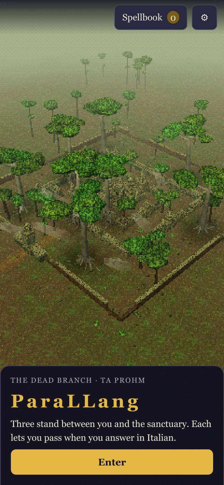 | 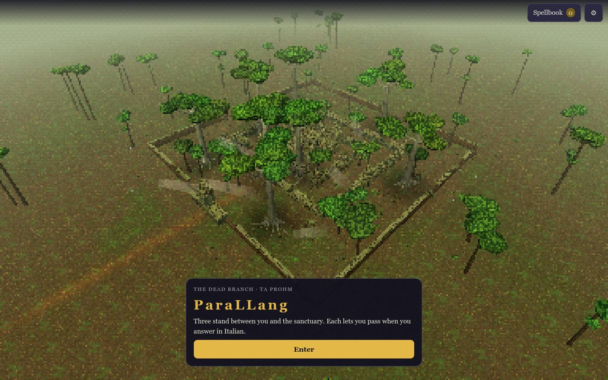 |
| Overview | 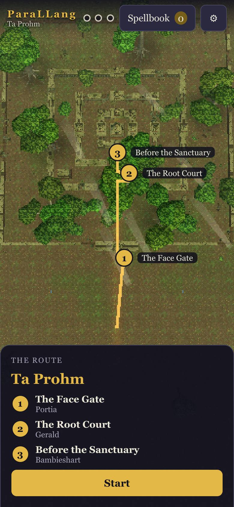 | 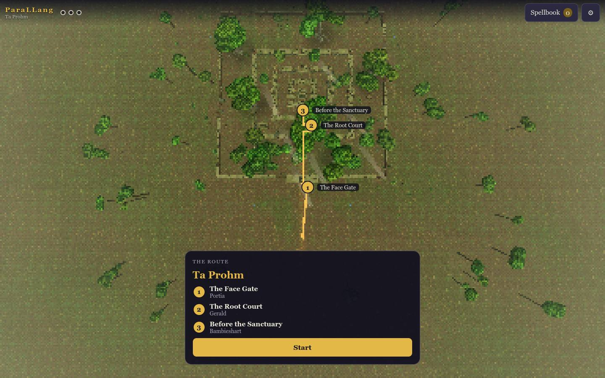 |
| Approach, site 1 | 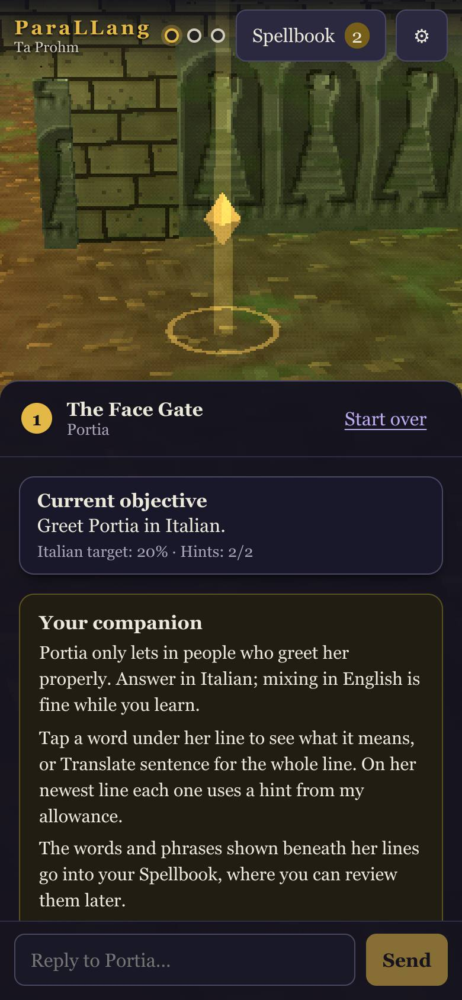 | 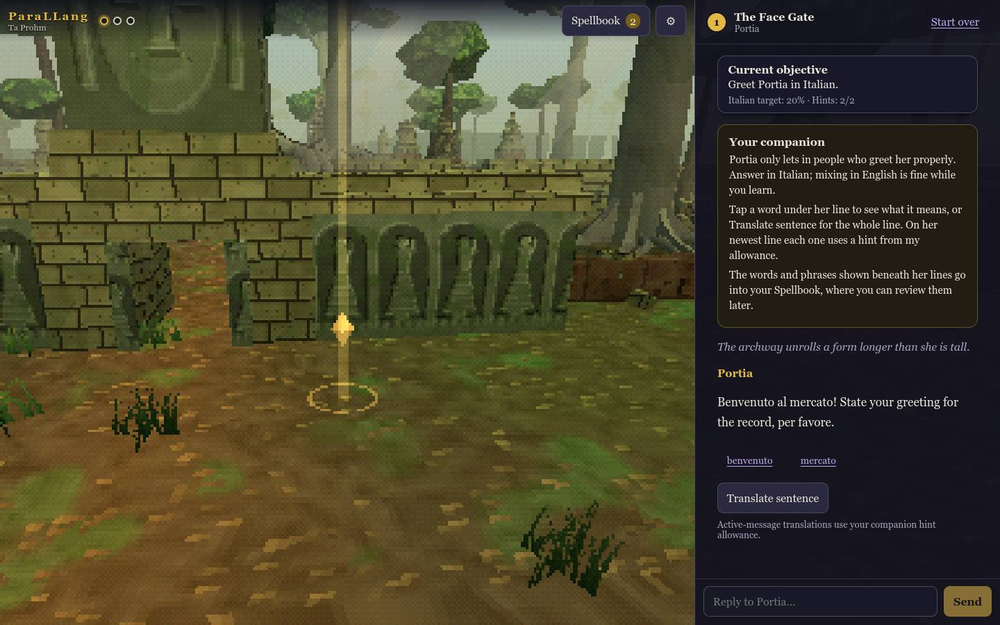 |
| Walk, through the gopura | 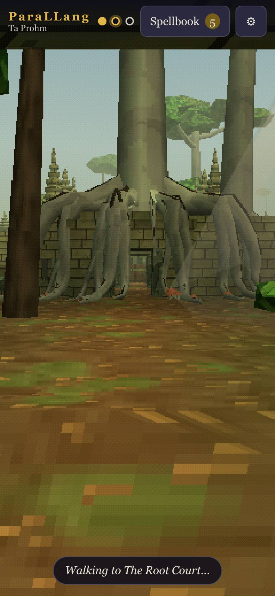 | 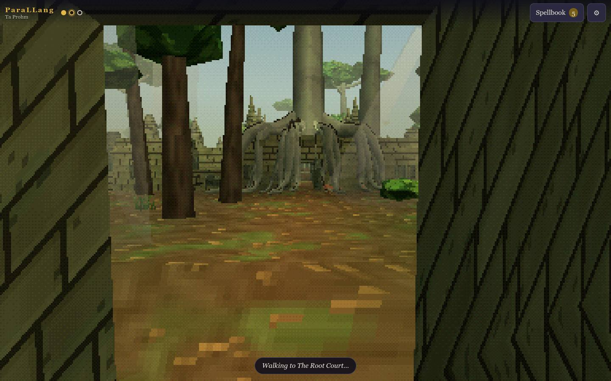 |
| Walk, through the gate tree | 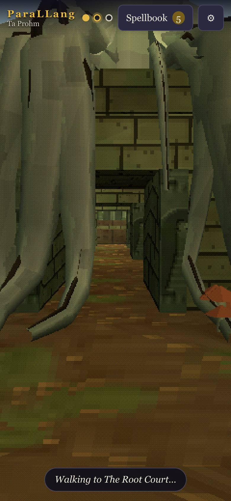 | 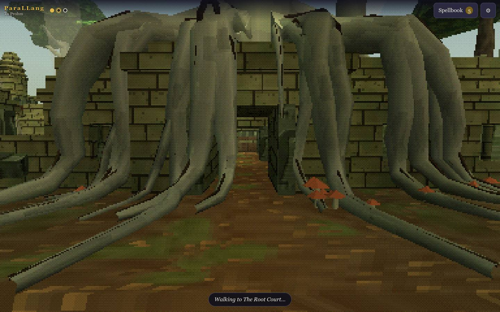 |
| Site 2 | 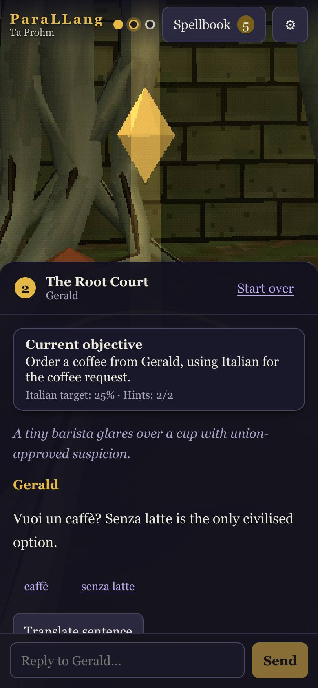 | 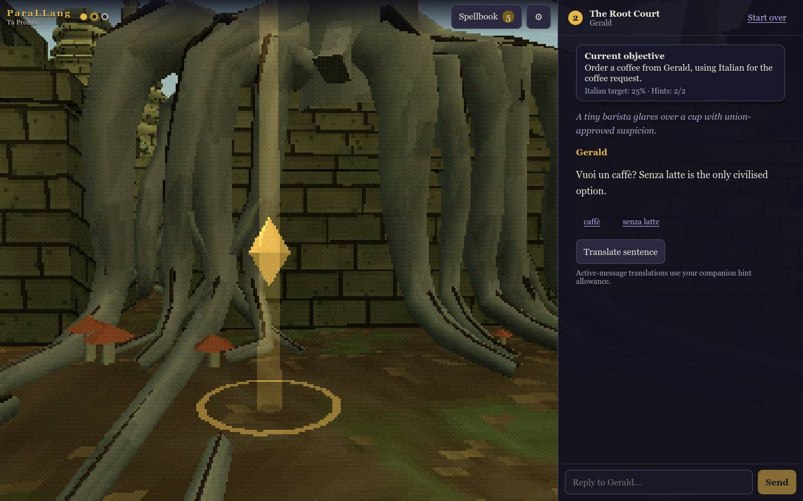 |
| Site 3 | 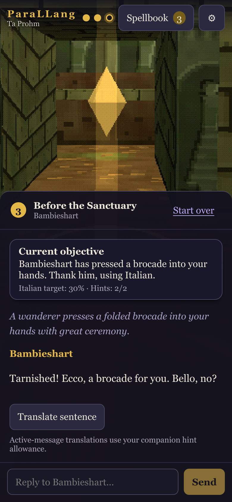 | 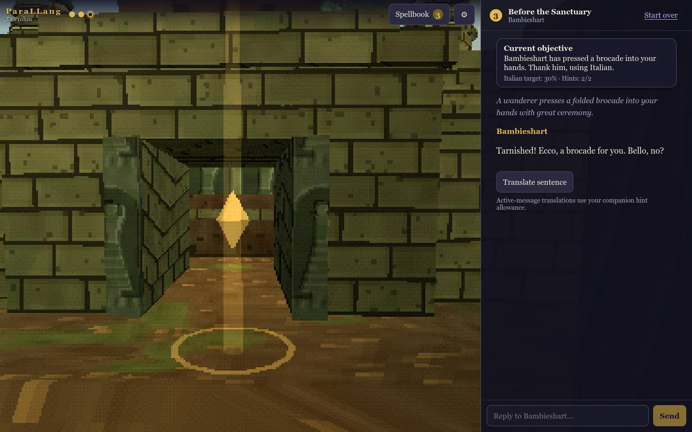 |
| Victory | 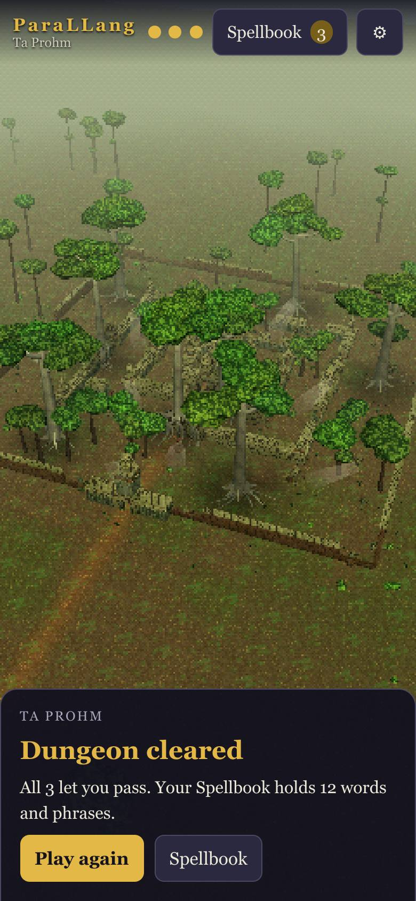 | 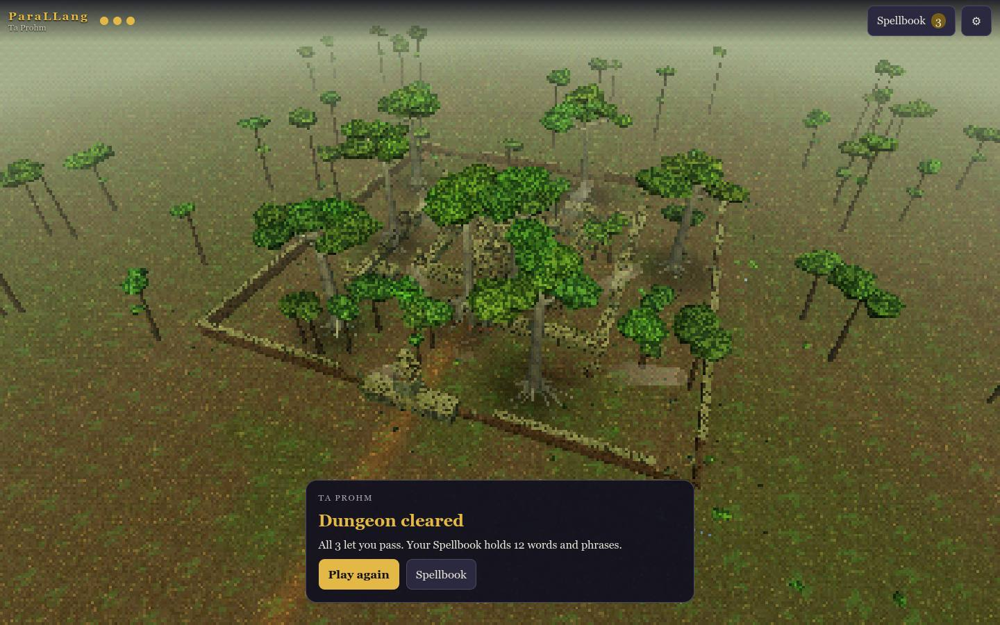 |

- **What the patch got wrong.** Its walk ended with the look-at point on the camera itself. Its store had a state
  field and an action both named `cameraArrived`, so the action overwrote the flag. Both are fixed and tested.
- **What the plan test found.** The committed route ran 0.3 m from the second enclosure's gate pavilion. Site 3 at
  [2.6, 11] faced a blank wall from 2.4 m. Site 3 is now on the axis at [0.3, 11.2]
  ([Amendment](architecture.md#amendment-2026-11-14-site-3-on-the-axis-later-sites-approached-at-eye-level-claude-during-the-build)).
- **Docker:** the image's install step ran in a scratch copy with the new lockfile and installed the server's 75
  packages. The Dockerfile now copies `aesthetic/package.json`, and `.dockerignore` lets that one file through.
- **Review.** Codex read the committed build and found five defects, all real and all fixed with a test that fails
  on the reviewed code ([Amendment](architecture.md#amendment-2026-11-14-fixes-from-codex-review-1-claude-after-the-build),
  [`trail/review-1.md`](trail/review-1.md)). The worst: `.dockerignore` kept `aesthetic/` out of the Docker build
  context while the Dockerfile now copied its manifest, so the first push to `main` would have failed Render's
  build. The other four were stale replies in the store and a failed "Start over" that showed no error.

## Decision
Keep the build on the branch `round-115-dungeon` until the owner says to merge. A push to `main` deploys the client
to GitHub Pages and restarts the Render server, which wipes its saves.

## Evidence
[`architecture.md`](architecture.md) (Design, Amendment, Outcome), [`trail/journal.md`](trail/journal.md),
[`trail/interview.md`](trail/interview.md), [`trail/review-1.md`](trail/review-1.md), [`shots/`](shots/) and `shots/shots.json`. Job logs
are in `~/workspace/r115-jobs/` on the cluster and are not committed.

## Claim boundary
- The conversations in the playthrough and in the pictures come from a fixture provider. Its lines are stand-ins
  written for the script; no model wrote them. The hosted chain (Pages to Render to Claude) was last checked in round
  114 and has not been run with this build.
- Software WebGL in headless Chromium says nothing about frame rate on a phone. iOS Safari is untested: the bottom
  sheet under the on-screen keyboard, the safe areas, and WebGL context loss when the tab returns from the background.
- Docker cannot run on the cluster. The image build is checked by the install step in a scratch copy and by a test
  that every `COPY` source passes `.dockerignore`; Render has not built this branch.
- GitHub Actions has not run this branch. The runners are slower than the cluster (round 114's mobile timeout).
- The plan test encodes the level's wall plan by hand from `aesthetic/src/scene/taprohm.js`. A change to the level
  needs the same change there.

## Open items
- **Owner:** look at the pictures, then say whether to merge to `main` (which deploys). Play one run on a phone
  against the hosted server and report the frame rate, the keyboard and anything that reads wrong.
- **Owner:** the walk starts on a button, and only the first site is approached from above. Both are Claude's
  choices (Decision 4, the Amendment).
- The sites have a beacon and no character or prop yet (deferred in round 114).
- The iPhone app has no dungeon. `aesthetic/native/TempleView.js` is the untested route to one.
- `tools/check_hosted.py` plays the market's start, not a dungeon start. A dungeon start against the hosted server
  needs the token from the owner.
