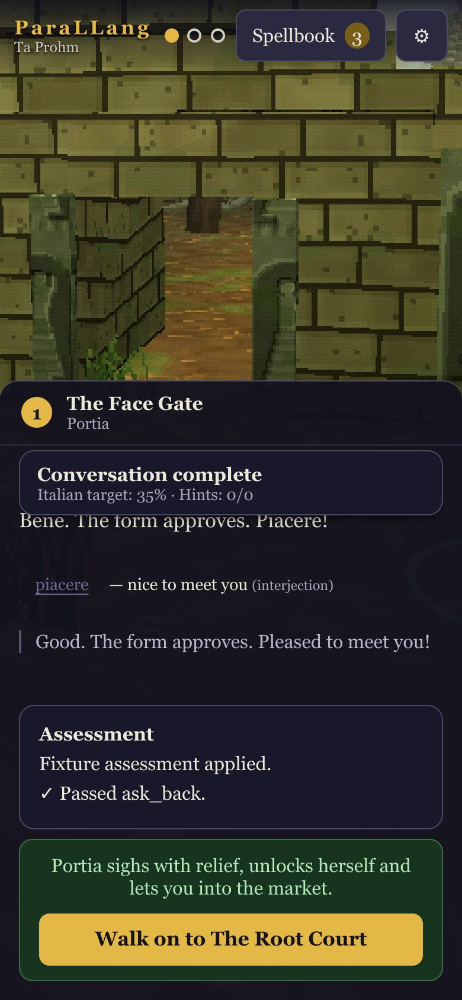
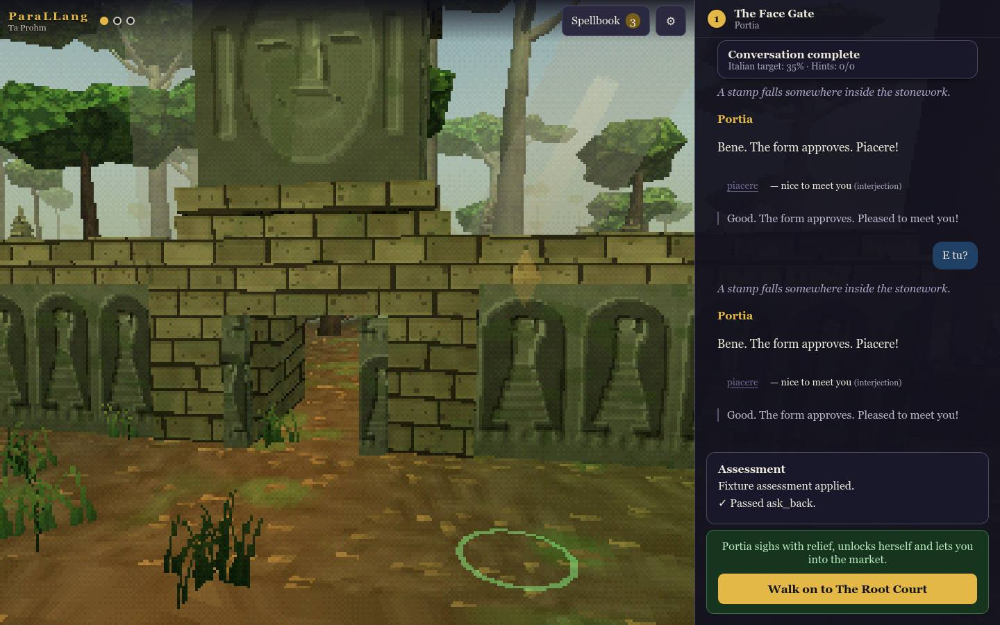
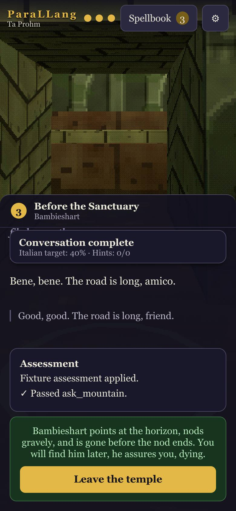
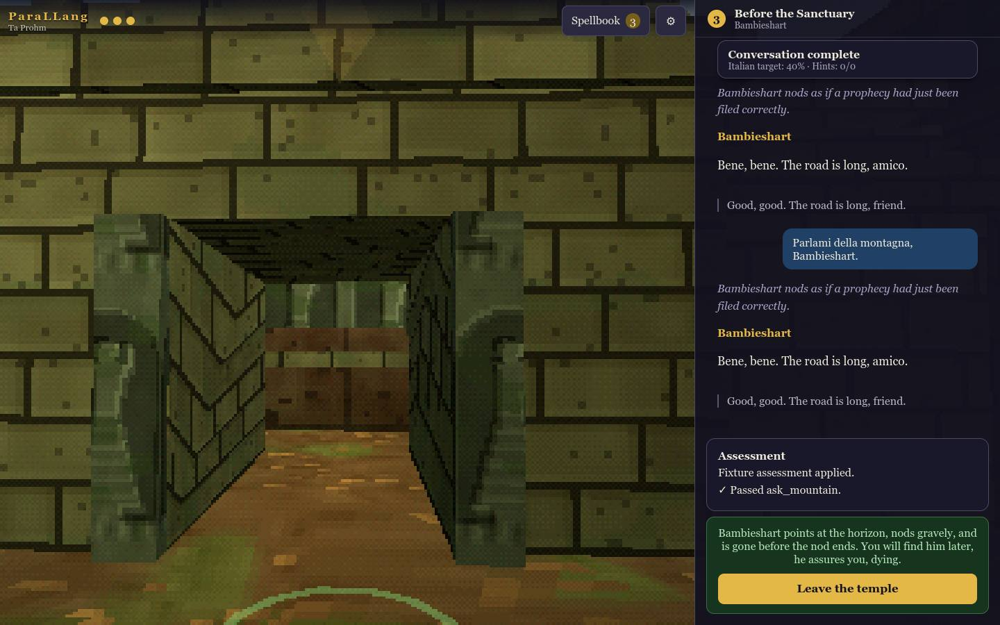
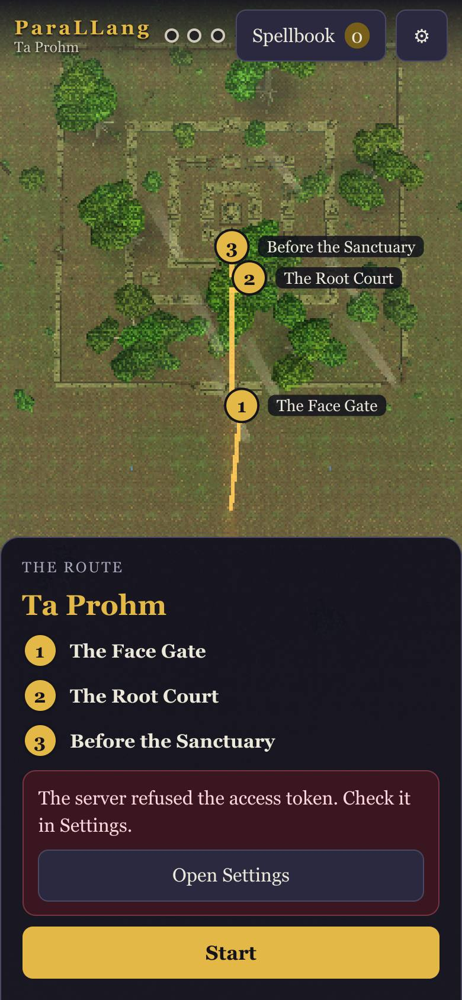
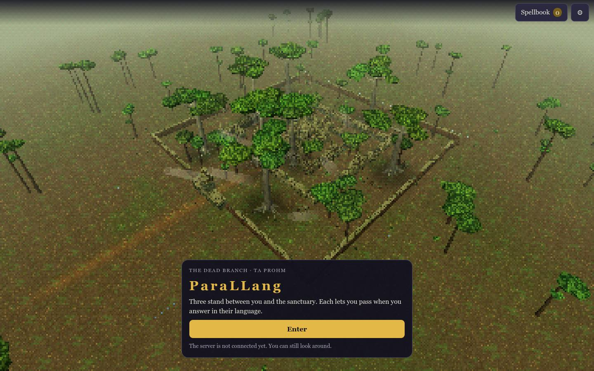

# Round 116 findings

## Question
Does the gameplay drive the camera inside an encounter as well as between encounters, and is the dungeon live?

## Finding
Yes to both. The camera now follows the conversation: it steps in for each objective the player closes, answers a
verdict with a brief push or pull, and turns to the way on when a site is resolved. A wiring test and the
real-browser playthrough fail if gameplay and camera come apart. The dungeon is deployed: GitHub Pages serves the
new build, Render built the new image, and the live site renders the level and the route. A conversation against
the live model is still unplayed, because the check has no access token.

## Method
The director gained `engage`, `onward` and `beat`, which shape the hold at a site and nothing else. The store counts
the objectives a conversation has closed and numbers each verdict. `DungeonView` passes both to the level view. The
coupling was tested at three levels: the director (Node), the screen with the three.js host mocked
(`camera-wiring.test.jsx`), and the built client in headless Chromium with assertions added to
`client/scripts/dungeon-shots.mjs`. Tests and the playthrough ran in Slurm jobs on node dada (CPU). The merge was
pushed at 23:16:07 UTC. The deploy was read from the public GitHub API and from the live URLs, and
`client/scripts/live-check.mjs` loaded the Pages site in headless Chromium inside a Slurm job.

## Results
- **Suites** (job 5402): server 418, client 69 (62 before the round), aesthetic 20, mobile 320, all passing.
- **Playthrough** (job 5401): 75 s per size, 0 problems. At every site it asserted: no dialogue sheet while the
  camera comes down or walks; at the dialogue's opening the camera holds at the site and looks at it; a closed
  objective brings the camera nearer; at the resolve the camera has stepped in and looks more than 3 m past the
  site; the walk starts within 1.5 m of where the camera stood.
- **What the pictures corrected.** At the last site the turn first aimed up at the sanctuary tower and met the inner
  gate's wall. It now aims at the sanctuary at eye level, through the gate's door.

| | Phone | Desktop |
|---|---|---|
| Site 1 resolved: stepped in, turned to the face gate, the ring green |  |  |
| Site 3 resolved: turned to the sanctuary through the inner gate |  |  |

- **Deploy.** Merge commit `d01c8a0` on `main`.
  - CI run [43652377367](https://github.com/marcellobarylli/ParaLLang/actions/runs/43652377367) and the Pages run
    [43652377445](https://github.com/marcellobarylli/ParaLLang/actions/runs/43652377445) succeeded by 23:17:39 UTC.
  - Pages: `version.json` changed from `0.1.0+mwgyz7ka` to `0.1.0+mwh0zw7i`.
  - Render: its GitHub deployment record for `d01c8a0` ("main - parallang") reads `success` at 23:16:37 UTC. This is
    the first real build of the image since `aesthetic/package.json` joined it, so review finding R1.1 of round 115
    is confirmed fixed. `/api/health` answers 200 and a request without the token gets 401.
  - Live site (job 5403): the level was ready 0.9 s after the page load (phone size) and 0.4 s (desktop size), the
    title and the route rendered, and "Start" showed "The server refused the access token. Check it in Settings."
    with the button to the settings. That reply came from Render across origins, so the page reaches its server.

| The live route, phone size | The live title, desktop size |
|---|---|
|  |  |

## Decision
The walk keeps its button (Decision 2). The dungeon stays deployed. Both are Claude's decisions under the owner's
"go ahead with the most reasonable solution"; the owner can reverse either.

## Evidence
[`architecture.md`](architecture.md), [`trail/journal.md`](trail/journal.md),
[`trail/interview.md`](trail/interview.md) (the owner's reply, verbatim), [`shots/`](shots/). Job logs are in
`~/workspace/r115-jobs/` on the cluster and are not committed.

## Claim boundary
- No conversation has been played against the live model with this build. The playthrough's lines are stand-ins
  from a fixture provider.
- The camera's reactions were judged on software WebGL in headless Chromium. Frame rate and feel on a phone, and iOS
  Safari's keyboard over the bottom sheet, are untested.
- A browser that has never held the access token starts at "The server refused the access token". The owner's
  browsers keep the token they entered in round 114, since the site's address and the storage key are unchanged; this
  was not observed.

## Open items
- **Owner:** play one run on the phone at https://marcellobarylli.github.io/ParaLLang/ and say how the camera reads:
  the step in, the turn at a resolve, the walk. Say whether the walk should start by itself.
- **Owner:** `PARALLANG_TOKEN=<value> node client/scripts/live-check.mjs` (in a Slurm job, with Chrome and
  puppeteer-core as in the handoff) starts the first live conversation from the cluster, at the cost of one model
  call.
- A resolved site could start the next site's greeting while the player reads, which would hide the hosted server's
  15 s start (deferred).
