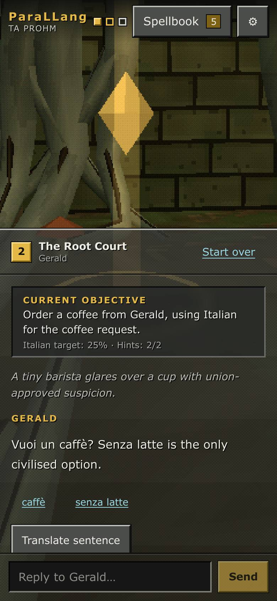
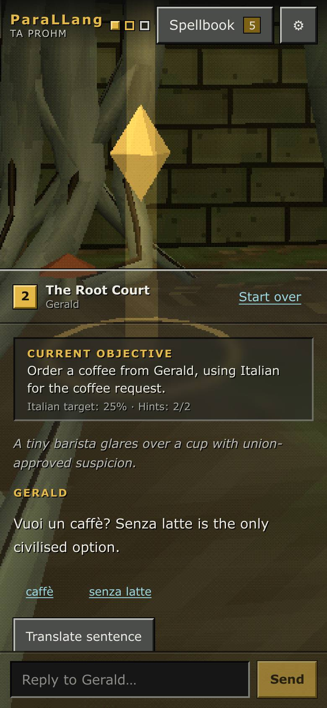
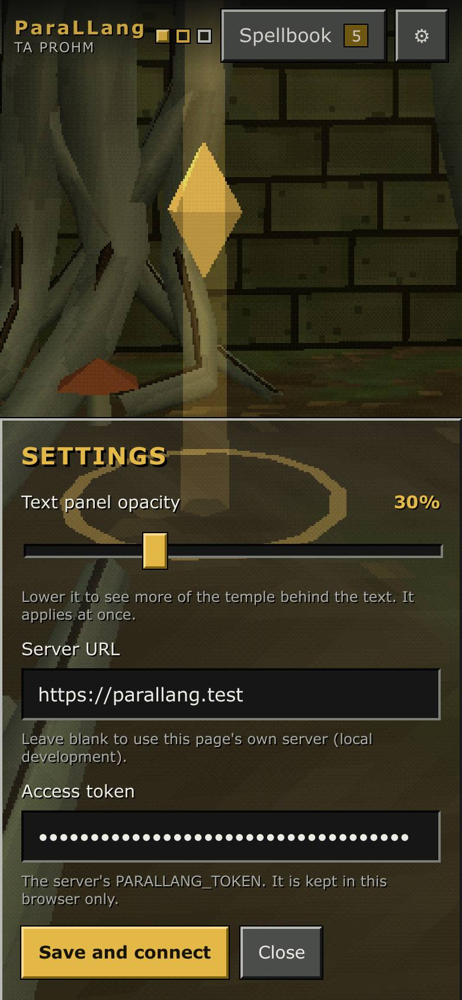
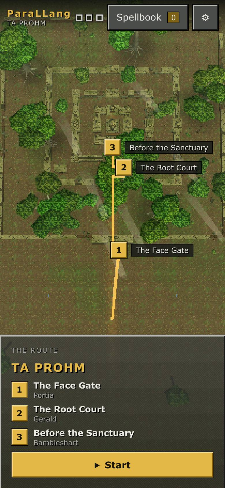
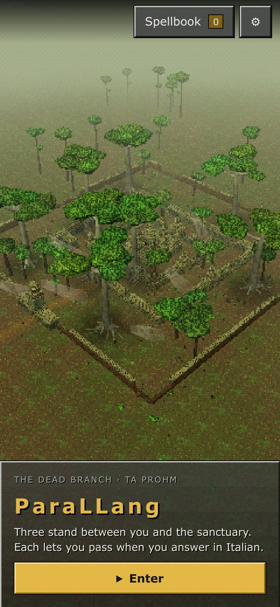
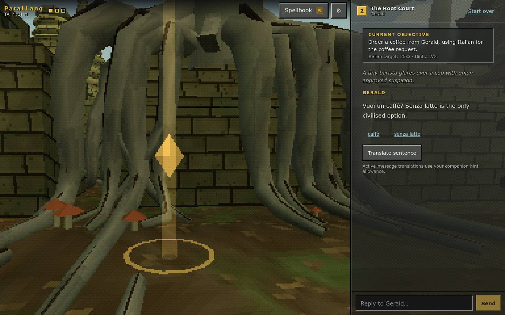

# Round 117 findings

## Question
After the owner's first run on the phone: does the dungeon screen reach the bottom edge of the screen, can the player
set how much of the level shows through the text panels, and do the panels look like a PS1 menu?

## Finding
All three are built, tested and deployed. Whether the strip is gone on the iPhone, and whether the look is right,
is for the owner to see: the cluster has no iPhone, and the strip's cause is inferred.

## Method
The owner sent three screenshots from an iPhone and three requests (the strip under the bottom sheet, a slider for
the panels' translucency, grey panels with hard corners in a PS1 menu look). The strip was diagnosed from the
screenshot and the page's manifest. The slider is a display preference with its own storage key. The look is a
rewrite of `client/src/index.css`. Tests ran in Slurm jobs on node dada (CPU); the playthrough
(`client/scripts/dungeon-shots.mjs`) moved the slider through the interface in a conversation. Each change was
pushed to `main` with `[skip render]`, so GitHub Pages took the new client and Render kept the running server.

## Results
- **The strip.** The screenshot shows the page opened from the home screen (no browser bars, the level under the
  status bar). There iOS keeps the layout area short by the status bar's inset, and `position: fixed; inset: 0` ends
  that much above the screen's bottom edge. Under `display-mode: standalone` the shell and the settings backdrop now
  take `height: 100vh`. `useInsets` measures the shell's rectangle, since `window.innerHeight` is short by the same
  amount.
- **The slider.** Settings has "Text panel opacity", 0 to 100% in steps of 5, default 70%. It applies at once and is
  stored under `parallang.display`. It makes no request: in the playthrough the conversation kept its id and version
  through the change. While Settings is open the dock is hidden and the settings sheet takes the panel's background
  over the level, so the sheet shows what the slider does.
- **The look.** Neutral grey windows with a bevel (light top and left, dark bottom and right) inside a black outline,
  a banded gradient with a 2 px dither, no rounded corner anywhere, Verdana with a hard one-pixel shadow, upper-case
  labels, bevelled buttons that reverse on a press, a blinking cursor on a card's main button, gold headings and
  pale cyan links. The gear is drawn as text, not as an emoji.

| 70% (the default) | 30% | Settings, the slider at 30% |
|---|---|---|
|  |  |  |

| The route | The title | Desktop, the side panel |
|---|---|---|
|  |  |  |

- **Suites** (job 5410): server 418, client 77 (69 before the round), aesthetic 20, mobile 320, all passing.
- **Playthrough** (job 5409): 77 s per size, 0 problems. New assertions: the installed-mode rule fills the window;
  the panels start at 70%; the settings sheet and then the dialogue sheet show 30% after the slider moves; the dock
  is hidden behind Settings; no element on the screen has a rounded corner.
- **Deploys.** `7eeadfd` (the strip): Pages run
  [43692812152](https://github.com/marcellobarylli/ParaLLang/actions/runs/43692812152) succeeded at 08:05:57 UTC.
  `f728a16` (the slider and the look): CI run
  [43693645537](https://github.com/marcellobarylli/ParaLLang/actions/runs/43693645537) and Pages run
  [43693645578](https://github.com/marcellobarylli/ParaLLang/actions/runs/43693645578) succeeded by 08:16:46 UTC.
  `version.json` reads `0.1.0+mwhk97i6`, and the live stylesheet holds the installed-mode rule and `--panel-alpha`.
  Render's last deployment is still `d01c8a0`, and `/api/health` answers 200.
- **The first live conversation.** The owner's second screenshot shows Portia's site against the live model: an
  assessment with one objective met, and a second answer being sent. Round 116's claim boundary ("no conversation
  against the live model") is closed by that picture for the first site.
- **The missing token.** The owner's token from round 114 was not in the page opened from the home screen. iOS gives
  such a page its own storage. Round 116's findings had expected the token to be there.

## Decision
The default opacity is 70%. The face is Verdana. Both are Claude's choices; the owner asked to "try" the slider and
left the "tweaks" open.

## Evidence
[`architecture.md`](architecture.md) (Diagnosis, two Amendments, Outcome), [`trail/journal.md`](trail/journal.md),
[`trail/interview.md`](trail/interview.md) (the owner's three requests, verbatim), [`shots/`](shots/). Job logs are in
`~/workspace/r115-jobs/` on the cluster and are not committed. The owner's screenshots are not in the repository.

## Claim boundary
- The strip's fix is untested on an iPhone. Chrome 131 cannot emulate `display-mode`, so the playthrough applies the
  rule without its condition; that shows the rule is harmless where the bug is absent, and nothing about iOS.
- The pictures come from headless Chromium on Linux, where the face falls back to DejaVu Sans. On the iPhone the
  face is Verdana, which is close but not the same.
- The sticky objective card blurs what scrolls under it (`backdrop-filter`). Where a browser lacks that, the card
  keeps 90% opacity.
- Text over a bright part of the level at a low opacity relies on the one-pixel shadow. Its legibility on the phone
  is the owner's judgment.

## Open items
- **Owner:** close the home-screen page and open it again, then say whether the strip is gone and how the look and
  the slider read. Name the opacity you settle on, and it becomes the default.
- Markers 2 and 3 overlap on the route screen at phone size, and the canopy hides the route line past site 1. The
  owner did not want these fixed now.
- From round 116: whether the walk should start by itself; prefetching the next site's greeting.
