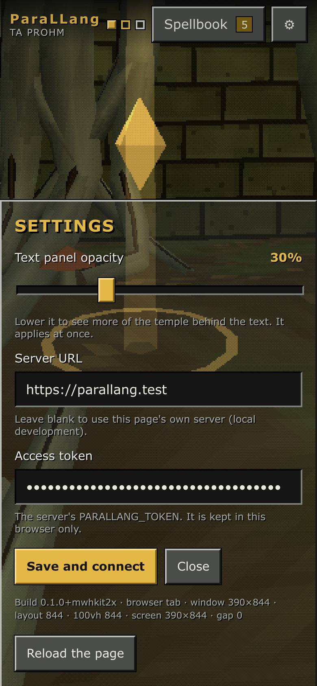

# Round 118 findings

## Question
Round 117's fix for the strip under the dock cut the bottom of the screen in the page opened from the iPhone's home
screen. Is the cut gone, and can the player see and load the newest build from inside the page?

## Finding
The cut is removed by construction: every panel now keeps its content inside the area iOS is known to show. Whether
the strip itself is gone is still unknown, because that depends on whether iOS paints below that area, which only the
owner's phone can show. Settings now names the build and the viewport's numbers and has "Reload the page".

## Method
The owner's screenshot of build `7eeadfd` was compared with the one before it. The layout was redesigned so that no
outcome on the phone cuts content, and the playthrough checks that property in headless Chromium with the
installed-mode rules applied and a gap of 62 px set by hand. Tests ran in Slurm jobs on node dada (CPU). The build
was pushed to `main` with `[skip render]`.

## Results
- **What round 117 got wrong.** It took the strip for the body showing under a short shell, and made the shell
  `100vh` high. The owner's screenshot shows the whole screen about 65 pt lower and the Start button cut at the old
  line. So `display-mode: standalone` matches and `100vh` is the screen's height, but a fixed element is clipped to
  the short layout area (`body { overflow: hidden }` is the viewport's clip). Between 08:05:57 and 08:29:02 UTC the
  live site cut the bottom 65 pt in the installed page, which holds the reply box.
- **The new layout.** In the installed page the document (`html`, `body`, `#root`) is `100vh` high and does not
  clip; the shell lies in it. `client/src/viewport.js` measures `100vh` minus the layout area's height and sets
  `--bottom-gap`; the route card, the travel caption, the dialogue sheet, the overlays and the settings sheet add it
  to their bottom padding. If iOS paints the strip, the panels' background and the level fill it. If not, the page
  looks as it did before round 117. In a browser tab the gap is 0 and nothing moves.
- **Settings.** A line such as `Build 0.1.0+mwhkp1a3 · installed · window 393×787 · layout 787 · 100vh 852 · screen
  393×852 · gap 65`, and a button "Reload the page", which loads the page's address with a fresh query string and so
  passes the browser's cache. If the site holds another build than the one running, the line says so and the button
  turns gold. The storage is per origin, so a reload keeps the token.

- **Suites** (job 5412): server 418, client 85 (77 before the round), aesthetic 20, mobile 320, all passing.
- **Playthrough** (job 5411): 77 s per size, 0 problems. On the route, in a conversation and in Settings, with the
  installed rules and a gap of 62 px: the shell reaches the window's bottom edge, the body does not clip, and the
  Start button, the reply box, the Send button, the scrolling area and the settings buttons each end 62 px higher,
  above the gap. The build named in Settings equals `version.json`.
- **Deploy.** `6076b49`: Pages run
  [43694594110](https://github.com/marcellobarylli/ParaLLang/actions/runs/43694594110) succeeded at 08:29:02 UTC.
  `version.json` reads `0.1.0+mwhkp1a3`, and the live stylesheet holds the new installed rules. Render's last
  deployment is still `d01c8a0`; `/api/health` answers 200.
- **CI failed once on `6076b49`.** Run
  [43694594256](https://github.com/marcellobarylli/ParaLLang/actions/runs/43694594256) failed in `npm test`. The log
  needs a GitHub login, which the cluster does not have. The same commit passes all four suites on the cluster under
  Node 24 (job 5412) and under Node 22.23.5 with `CI=true`, the version CI uses (job 5413). The run's length points
  at the last suite (mobile), which timed out on GitHub's runners once before (round 114). The closing commit of this
  round is pushed with CI on, as a second run; its result is in the journal.

## Decision
The content stays inside the layout area until the owner confirms that iOS paints the strip. Moving it down by the
gap is one line less of padding and is deferred to that confirmation.

## Evidence
[`architecture.md`](architecture.md), [`trail/journal.md`](trail/journal.md),
[`trail/interview.md`](trail/interview.md), [`shots/`](shots/). Job logs are in `~/workspace/r115-jobs/` on the
cluster and are not committed. The owner's screenshots are not in the repository.

## Claim boundary
- Nothing here ran on an iPhone. That iOS paints a document taller than its layout area comes from reports of the
  same bug, not from a test.
- With the taller document the page could in principle be dragged by the height of the gap. `overscroll-behavior`
  is set against it; the phone decides.
- If the phone reports no gap (the numbers in Settings will show it), the layout equals a browser tab's and the
  strip remains.

## Open items
- **Owner:** in the installed page, open Settings and tap "Reload the page" if the build is not `0.1.0+mwhkp1a3` or
  later. Then send a screenshot of Settings: it shows the build, the numbers, and whether the strip is gone.
- If the strip is gone: move the content down by the gap. If it remains: the numbers say what to try next.
- From round 117: the opacity to make the default; markers 2 and 3 overlapping on the route screen.
