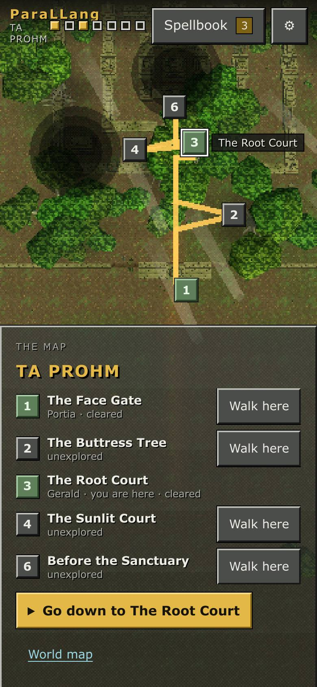
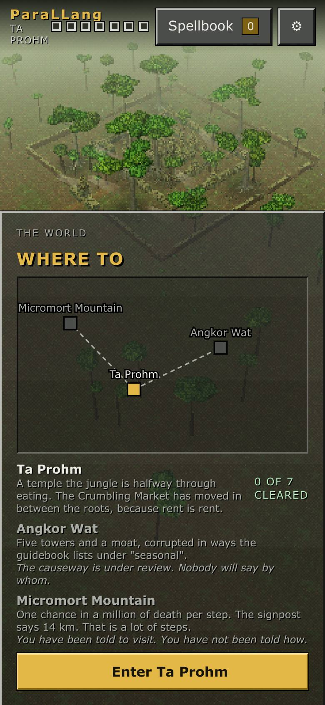

# Round 119 findings

## Question
Can the web client's Ta Prohm dungeon become a map the player moves over freely, with fog of war, under a world map
of places, without the camera walking through stone?

## Finding
Yes. The dungeon is a map of seven sites joined by eight paths, and a world map lies above it. The player picks
where to walk, a character lets them pass once answered, and The Sanctuary is sealed until the six other sites are
cleared. The built client plays all seven sites in a headless browser at a phone and a desktop size with no
problem. Nobody has played it against the live model or on an iPhone.

## Method
The design was drafted, critiqued by Codex and frozen before the build. The rules were built on the server as pure
functions, the client was rewired to show what the server reports, and the camera was given walks along any path in
either direction. A second Codex pass reviewed the finished diff. Every suite ran in Slurm jobs on node dada (CPU).
The playthrough (`client/scripts/dungeon-shots.mjs`) runs the built client in headless Chromium with software WebGL
against an in-process server whose provider is a fixture: no model wrote a line.

## Results
- **The map.** `content/world/dungeons/ta_prohm.yaml` holds the seven sites, eight paths, the start (The Face Gate),
  the goal (The Sanctuary) and its seal. The four new sites are The Buttress Tree (Mortimer), The Sunlit Court
  (Flick), The Library (Marginalia) and The Sanctuary (Errata). Every path crosses an enclosure through its east
  gate passage. The first-guess coordinates passed the wall plan and were not moved.

- **The rules** are in `server/src/dungeon.js`: fog (current, visited, known, hidden), the seal, the pass rule,
  clearing, completion and a new run. `GET /api/dungeons/:id/map` sends each site's state and whether it can be
  walked to now; `POST /api/dungeons/:id/move` walks. A save from rounds 114 to 118 keeps its cleared sites.
- **The world map** shows Ta Prohm (open), Angkor Wat and Micromort Mountain (known, closed, each with a line saying
  why). The Bone Dome is in the file and hidden. Only the client reads the file.

- **The client.** New phases `world` and `site`. The ways on appear after a conversation and on a site's card; the
  temple map lists the sites out of the fog with a "Walk here" on each reachable one. "Leave" takes the player out
  of a conversation they cannot finish, and the way back to a visited site is open.
- **The camera.** Two defects were found before any player met them, both by checks against the level's wall plan:
  - A half turn at the start of a walk swung the camera through the piers of a gate passage. Walks now start with a
    turn on the spot. A director test walks all 60 combinations of arriving at a site and leaving it and fails if
    the camera is inside the plan's stone.
  - Going down from the map to The Root Court crossed a gallery roof (Codex review, R1.2). From the sky the camera
    now crosses above everything and comes down over the spot where it will stand. A test covers 46 descents at two
    screen shapes.
- **Critique and review.** Codex's critique of the draft returned nine findings; all were accepted, and six of them
  removed parts of the plan. Its review of the build returned six defects (two high); all were real and are fixed,
  each with a test. The second high one: a page still running an older build met the new server's answer and
  failed with a JavaScript error. The server now answers the old path with "This page is older than the server.
  Open Settings and tap "Reload the page"."
- **Suites** (job 5444): server 426, client 101, aesthetic 20, mobile 320, all passing. Before the round: 418, 85,
  20, 320.
- **Playthrough** (job 5445): 189 s per size, 0 problems. It walks all seven sites by the ways on, the temple map
  and a site card, leaves a conversation and returns to it, checks the seal with five of six cleared, and checks
  the map's labels and fog at four moments. The pictures are in [`shots/`](shots/).

- **Deploy.** `113f661` was pushed at 10:55:16 UTC. Pages run
  [43706390704](https://github.com/marcellobarylli/ParaLLang/actions/runs/43706390704) succeeded at 10:56:43, and
  `version.json` reads `0.1.0+mwhpyza1`. Render's deployment of the same commit reports `success`, and `/api/health`
  answers 200. `client/scripts/live-check.mjs` (job 5447) loaded the live page at both sizes: the title, the world
  map, the temple map with its three unfogged sites, and the expected refusal without a token. The server's new
  routes cannot be told apart from the cluster without the token: every path answers 401.
- **CI failed once on `113f661`.** Run
  [43706390799](https://github.com/marcellobarylli/ParaLLang/actions/runs/43706390799) failed in `npm test` after
  18 s. The deploy workflow ran `npm test` on the same commit and passed. The log needs a GitHub login. The server
  and client suites then passed five times in a row on the cluster under Node 22.23.5 with `CI=true` on two cores
  (job 5446). The cause is not known; round 118 saw the same pattern once.

## Decision
The map is merged to `main` and deployed (Q4). Rounds 120 (the party) and 121 (levels) attach to it: the party
offer to a cleared site, the level gates to the seal and to the closed places.

## Evidence
[`architecture.md`](architecture.md) (the design, both Amendments, the two disposition tables),
[`trail/journal.md`](trail/journal.md), [`trail/critique-1.md`](trail/critique-1.md),
[`trail/review-1.md`](trail/review-1.md), [`shots/`](shots/) with `shots.json` (the camera's state at each
picture). Job logs are in `~/workspace/r119-jobs/` on the cluster and are not committed.

## Claim boundary
- Nothing here ran against the live model. Mortimer, Flick, Marginalia and Errata have been played live on the
  market's map (rounds 010 to 015), not from a dungeon start. Their lines in the pictures are stand-ins written for
  the playthrough script.
- Nothing ran on an iPhone. Frame rate, the taller cards over the on-screen keyboard, and the map card's height on
  the owner's phone are unverified.
- The wall plan is two-dimensional and has no trees. A camera coming down or going up over a site that stands under
  a gate pavilion (Before the Sanctuary, The Sanctuary) crosses that pavilion's roof for a few frames, and a
  descent may pass through a tree's crown. The way up from a site to the map still uses the slanting blend.
- For some minutes after the push the client and the server are different builds. The new client names an old
  server and the new server names an old client; neither can play until both are deployed.
- The Render deploy wipes every save on the free plan, the owner's run included.

## Open items
- **Owner:** play the map on the phone. Things only the phone shows: whether the temple map's card leaves enough of
  the map visible, whether seven pips fit beside the title, and the frame rate on the walks.
- **Owner:** the site names (The Buttress Tree, The Sunlit Court, The Library, The Sanctuary), the world map's
  descriptions and its three "closed" lines are Claude's. Replace any of them in the two content files.
- Errata's objective speaks of "the market's stalls" and Portia lets the player "into the market". The encounters
  are the market's, played in the temple. The world map says the market has moved in between the roots.
- The first approach to The Face Gate is now a descent over the avenue and no longer round 115's crane shot.
- Not done, by design: travel over several sites in one pick, tapping a site on the level itself, Errata's forced
  review before the fight, a second open place.
- On the login node, `npx vitest run src` in `client/` was run once by mistake. It includes `proxy.test.js`, which
  binds 127.0.0.1 ports for under a second. The cluster's rule forbids that. `docs/handoff.md` now says to name the
  folders.
