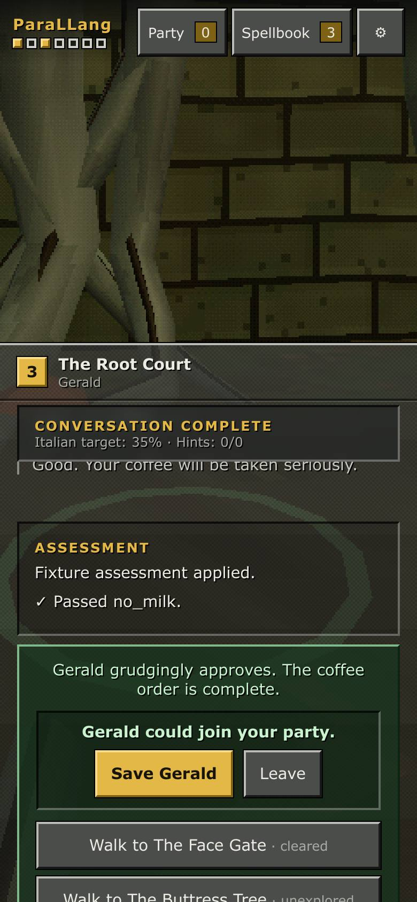
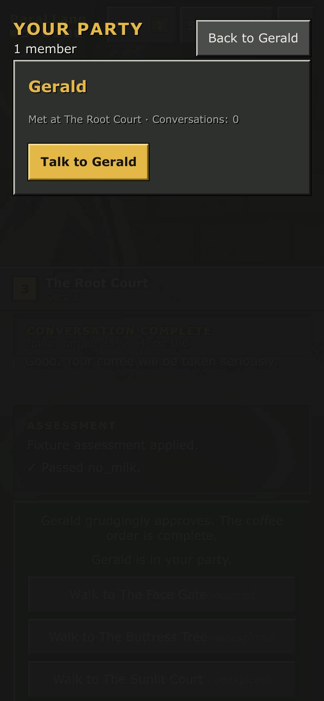
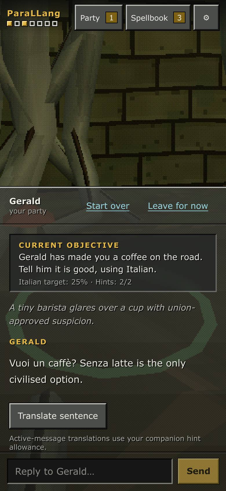

# Round 120 findings

## Question
Can the party of the iPhone app (save a defeated character, talk to them again anywhere) work in the web client's
dungeon with the server as it is?

## Finding
Yes, with one field added to the server. After a saveable character lets the player pass, the player can save them
from the conversation or later from the site's card, and talk to them from a Party panel wherever they are outside
a conversation. The built client plays this in a headless browser with no problem. No party conversation has been
played against the live model from the dungeon, and nothing ran on an iPhone.

## Method
The plan was drafted, critiqued by Codex and frozen before the build. The client was built on round 119's map; the
server changed in one place. A second Codex pass reviewed the finished diff. Every suite ran in Slurm jobs on node
dada (CPU). The playthrough runs the built client in headless Chromium against an in-process server with a fixture
provider: no model wrote a line.

## Results
- **The server** sends `saveable` on each site of the dungeon's map (null under the fog). Its party code is
  untouched: recruit, the party list, party conversations and their count are those of rounds 021 to 047.
- **The offer.** A resolved conversation with a saveable character shows "{name} could join your party." with
  "Save {name}" and "Leave", above the ways on. A cleared site's card keeps the invitation.

- **The Party panel** lists each member with the temple site they were met at and their finished conversations, the
  note for a deeper conversation after three, and "Talk to {name}".

- **A talk** opens where the player stands: on the title, either map, a site's card, after a conversation, or on the
  victory screen. The camera does not move. The sheet's header names the member and "your party". Leaving returns
  to where it was opened; from the resolved Sanctuary it returns to the victory screen, so "Leave the temple" is
  not lost.

- **The critique changed the design in three ways that matter to a player.** The draft promised that an unfinished
  party conversation could always be resumed, which the dungeon's site starts would have broken silently: the
  promise is now "until another conversation starts", and the button reads "Leave for now". The app's story hint
  ("… until Gerald tells you a story") was cut, because this client's Spellbook shows no stories. Talk works on
  the title screen, which a player with a party reaches after "Play again" and a reload.
- **The review** found four defects in the store's timing, all fixed with tests: a Talk the player walked away from
  left every Talk button disabled; a late recruit reply put an older party back; a late greeting closed a Spellbook
  opened meanwhile. One finding was rejected (see the claim boundary).
- **The phone's top bar** could not hold the pips beside the title once the Party button joined. The pips now sit
  under the title on a narrow screen. The first build drew them over it, which only the picture showed.
- **Suites** (job 5454): server 428, client 112, aesthetic 20, mobile 320, all passing. Before the round: 426, 101,
  20, 320.
- **Playthrough** (job 5455): 192 s per size, 0 problems. Besides round 119's walk through all seven sites it saves
  Gerald, reads the panel, talks to him where the camera stands, finishes the conversation, and checks the count
  and the top bar's layout. The pictures are in [`shots/`](shots/).

- **Deploy.** `448ccad` was pushed at 11:47:44 UTC. Both workflows passed this time (CI 43710639704, Pages
  43710639781); `version.json` reads `0.1.0+mwhruono`; Render's deployment of the same commit reports `success` and
  `/api/health` answers 200. `client/scripts/live-check.mjs` (job 5456) loaded the live page at both sizes.

## Decision
The party is merged to `main` and deployed (round 119, Q4). Round 121 is levels.

## Evidence
[`architecture.md`](architecture.md) (the design, both Amendments, the two disposition tables),
[`trail/journal.md`](trail/journal.md), [`trail/critique-1.md`](trail/critique-1.md),
[`trail/review-1.md`](trail/review-1.md), [`shots/`](shots/) with `shots.json`. Job logs are in
`~/workspace/r120-jobs/` on the cluster and are not committed.

## Claim boundary
- Nothing here ran against the live model. The party conversations were played live in the app's rounds (022, 023,
  047, 048), where the scene named in the prompt is a market location. From the dungeon the prompt still names the
  market location the save stands at, while the screen shows a temple site.
- Nothing ran on an iPhone. The top bar's three buttons at the owner's phone width are checked at 390 px in
  Chromium only.
- An unfinished party conversation does not survive the next site conversation. The app keeps it.
- For the minutes between the two deploys the new client may talk to round 119's server. A cleared site's card then
  shows no invitation (review R1.4, rejected). Render's deploy wipes the saves, so no cleared site outlives that.
- The client's fake party in its tests restates the server's rules. A change to the server's party rules needs a
  change there too.

## Open items
- **Owner:** the two workflows on GitHub fail now and then in `npm test`. On each of round 119's two pushes one of
  the two failed and the other passed on the same commit; the suites passed five times in a row on the cluster. The
  log needs a GitHub login. [`trail/ci-annotations.patch`](trail/ci-annotations.patch) makes both workflows put the
  failing tests into the run's annotations, which can be read without a login. Claude wrote it and did not push it:
  a change to the workflows was not asked for. Apply it with `git apply` if wanted. A failed Pages workflow leaves
  the old client live beside the new server; a push with `[skip render]` runs it again.
- **Owner:** play the party on the phone: the offer, the panel, a talk.
- The stories a member tells after three conversations are not shown in this client (the Spellbook has no
  fragments view). The app shows them.
- A party role in other encounters was offered in round 119 and not chosen.
