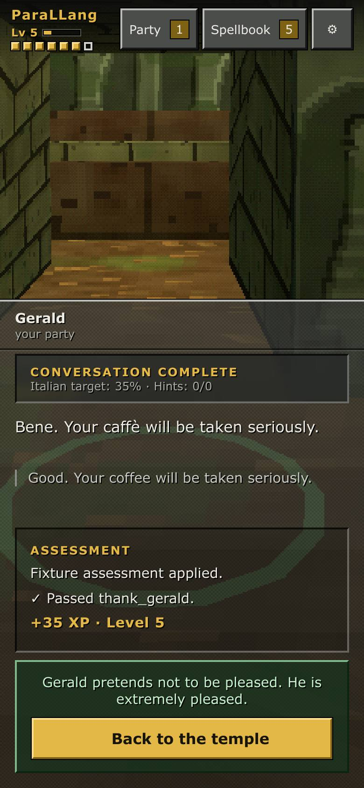
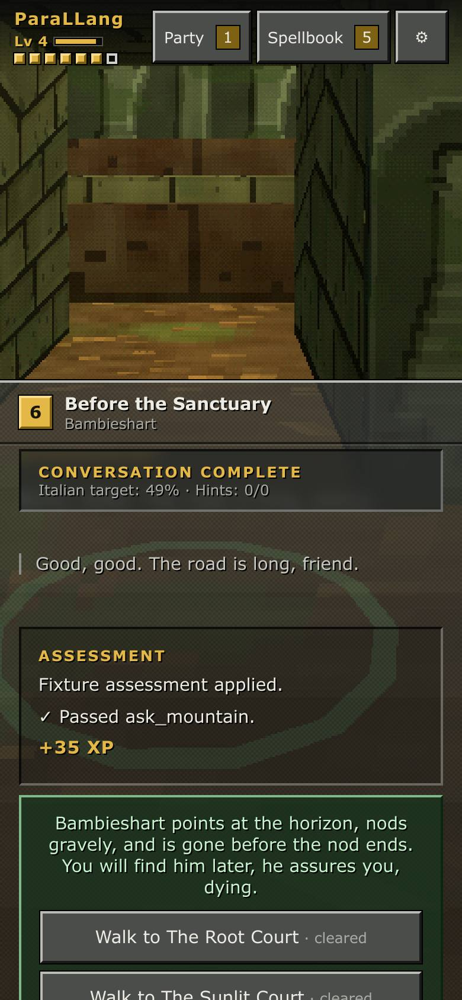

# Round 121 findings

## Question
Can the dungeon give the player experience and levels, so that a level opens sealed places and raises how much of
the target language the characters speak, without changing the iPhone app's play?

## Finding
Yes. The player earns XP for objectives, finished conversations and due reviews, the level is derived from it, The
Library opens at level 3 and The Sanctuary at level 5, and each level adds 0.03 to the target-language ratio of a
dungeon site's conversation. The built client plays this in a headless browser with no problem. What the live model
does with the higher ratio is not measured, the numbers are a first choice, and nothing ran on an iPhone.

## Method
The plan was drafted, critiqued by Codex and frozen before the build. XP is awarded inside the two commits the
server already had. A second Codex pass reviewed the finished diff. Every suite ran in Slurm jobs on node dada
(CPU). The playthrough runs the built client in headless Chromium against an in-process server with a fixture
provider: no model wrote a line.

## Results
- **Experience.** 10 XP for each objective a turn closes, 25 for a conversation that resolves (a site's or a party
  member's), 5 for a correct review of a due card. A held pass, a replayed attempt, a wrong, revealed or practice
  review earn nothing. The save holds `progression: { xp }`.
- **Levels.** Level L starts at `10 × (L − 1) × (L + 4)` XP: 0, 60, 140, 240, 360, 500. The top bar shows "Lv 4"
  and a bar to the next level; an answer that earned XP says "+35 XP", and the one that reaches a level adds
  "Level 5".

- **Level seals.** The Library asks for level 3 and The Sanctuary for level 5 besides its six sites. The six sites
  give 300 XP, which is level 4, so the playthrough finds the Sanctuary sealed with "opens at level 5 (you are
  level 4)", talks to Gerald once more (45 XP) and enters. In a complete run no gate is sealed.

- **Difficulty.** A dungeon site's conversation started at level 3 asks the narrator for 6 points more of the
  target language than the content's ratio, from its greeting to its last line, and shows that on the sheet. A
  conversation keeps the ratio it started with when the player crosses a level inside it.
- **The critique** found that the client walks by its cached map, so XP from a party talk or a review would have
  left the Sanctuary's walk disabled at level 5. A reply that raises the level now reads the map again. It also cut
  the levels on the world map's places, which stay closed and so could not keep the promise "Opens at level 6".
- **The review** found six defects, all fixed. Two were high:
  - The ratio bonus sat in the shared session start, so the iPhone app's market conversations would have grown
    harder with XP the app does not show. The bonus now applies to a dungeon site's conversation only.
  - A page of rounds 119 or 120 kept open across the deploy would show the Sanctuary sealed with no reason and
    never open it. The dungeon's routes now ask for the client's contract, and an older page is told: "This page is
    older than the server. Open Settings and tap "Reload the page"."
- **Suites** (job 5461): server 436, client 119, aesthetic 20, mobile 320, all passing. Before the round: 428, 112,
  20, 320.
- **Playthrough** (job 5462): 194 s per size, 0 problems. It checks each conversation's XP, the level in the top
  bar, the level seal and its wording, the level-up line, and that the top bar's title, level, pips and buttons do
  not overlap at 390, 600, 720, 760, 1024 and 1440 px. The pictures are in [`shots/`](shots/).

- **Deploy.** `7b02e41` was pushed at 12:43:01 UTC. Both workflows passed (CI 43715255513, Pages 43715255688);
  `version.json` reads `0.1.0+mwhttwfa`; Render's deployment of the same commit reports `success` and `/api/health`
  answers 200. `client/scripts/live-check.mjs` (job 5463) loaded the live page at both sizes.

## Decision
Levels are merged to `main` and deployed (round 119, Q4). The three integration rounds the owner asked for are
done. Next are the characters at the sites (round 119, Q5).

## Evidence
[`architecture.md`](architecture.md) (the design, the Amendment, the two disposition tables),
[`trail/journal.md`](trail/journal.md), [`trail/critique-1.md`](trail/critique-1.md),
[`trail/review-1.md`](trail/review-1.md), [`shots/`](shots/) with `shots.json`. Job logs are in
`~/workspace/r121-jobs/` on the cluster and are not committed.

## Claim boundary
- Nothing here ran against the live model. The higher ratio is a number in the narration prompt (for example 31%
  in place of 25%); what Claude writes at it, and whether a beginner can still follow at level 5, is not measured.
- The numbers are Claude's first choice and are not tuned by play: the three awards, the level curve, levels 3 and
  5, and 0.03 per level.
- Every conversation earns XP, also the market's in the iPhone app, which shows no level and uses none. The ratio
  bonus and the level seals are the dungeon's.
- A party member's conversation is not harder at a higher level. The owner's choice said "the characters speak"
  more of the target language; this round applies that to the sites.
- Nothing ran on an iPhone. The top bar now has three rows on a narrow screen (title, level, pips).
- A page older than this round's contract cannot play until it is reloaded. That is by design.

## Open items
- **Owner:** the numbers. `XP` in `server/src/learning-service.js`, `levelStartsAt` and `RATIO_PER_LEVEL` in
  `server/src/language-engine.js`, `requires_level` in `content/world/dungeons/ta_prohm.yaml`.
- **Owner:** whether a party member's conversation should also speak more of the target language at a higher
  level.
- A live run at level 1 and at level 5 of the same site, to see what the ratio bonus does to the lines.
- The world map's places have no level. They get one with their dungeon.
- The iPhone app shows no level.
