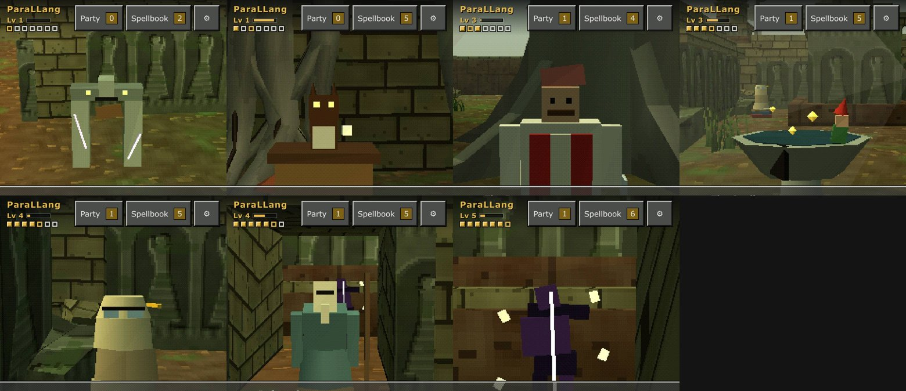

# Round 122 findings

## Question
Can each site of the dungeon show its character as a figure in the level's PS1 look, built in code, inside the
scene's triangle budget and inside what a phone's screen shows of a conversation?

## Finding
Yes. Seven figures built from boxes, cones and cylinders stand at the seven sites in place of the beacons. Each
follows its character's sheet, turns to the camera, and fits a phone's view of the conversation. They are judged
from headless screenshots by Claude. The owner has not seen them, and nothing ran on an iPhone.

## Method
The plan was drafted, critiqued by Codex and frozen before the build. The figures were built in the `aesthetic`
package and looked at in a gallery (`client/scripts/figure-shots.mjs`) twice before they went into the game. A
second Codex pass reviewed the finished diff. Every suite ran in Slurm jobs on node dada (CPU). The gallery and the
playthrough run the built client in headless Chromium with software WebGL; the playthrough's server uses a fixture
provider.

## Results
- **The seven figures**, at a phone's size, as the conversation shows them above its sheet:

  From the left, top row: Portia, a stone archway with eyes on her lintel, a mortar mouth and two glowing threads;
  Gerald, a horned imp in an apron with a cup, on his coffee cart; Mortimer, broad, in a striped apron, with a ham
  for a hat and a cleaver; Flick, a gnome in a red cap on the rim of a cracked basin, with sparks (Marginalia is in
  sight behind him). Bottom row: Marginalia, a segmented worm on a heap of books with half-moon spectacles and a
  pencil; Bambieshart, stooped, in a banded coat, with a long pale face and a staff (Errata's seam shows through the
  gate behind him); Errata, a misaligned dark figure with a bright seam and drifting letters.
- **The numbers.** 986 triangles for the seven (120 to 156 each, limit 160). The level has 62,408, the path ribbons
  and fog patches 298, so the scene counts 63,692 of the style's 64,000. No figure is taller than 2.18 m or reaches
  further than 0.88 m from its axis.
- **What the critique changed.** Draft 1 had figures up to 2.5 m and 400 triangles, parts that moved by themselves
  and a step aside on a resolve. Codex showed that a phone cuts a tall figure, that seven such figures break the
  scene's budget, and that a step aside puts Errata into a gate pier. The figures became smaller, lighter and still.
- **Two things the pictures and tests forced during the build** (the first Amendment):
  - With the top bar and the sheet, a phone shows from about 0.9 to 1.8 m at a site once the camera has stepped in.
    The tall figures were scaled down until every face is between 1.2 and 1.5 m (Portia's is at 1.8 m; the start
    site's camera stands 9.5 m back).
  - The camera's way on from a site starts at the site's point, so on three ways it walks through the place where
    the character stands. A figure now shrinks away between 2.1 and 1.3 m. The playthrough reads Gerald's figure
    every frame on the walk from The Root Court to The Sunlit Court and checks exactly that.
- **The review** found three small defects. With reduced motion on, a figure no longer bobs or hops. One finding was
  rejected in part (the count of triangles, see the claim boundary).
- **A flaky test found.** `server/test/greeting-prefetch.test.js` ("a start that took a pending greeting whose call
  then timed out…") failed once in job 5482. It waited a fixed 5 ms for the start to take the pending greeting; on
  a busy machine the greeting timed out first and the start made a fresh call. It now waits for the start to have
  taken it. This round did not touch that code. It is the likely cause of the failures on GitHub's runners in
  rounds 118 to 120 (a server-suite failure about 18 s into `npm test`), which the cluster had not reproduced.
- **Suites** (job 5484): server 436, client 120, aesthetic 43, mobile 320, all passing; the fixed test passed eight
  times in a row. Before the round: 436, 119, 20, 320.
- **Playthrough** (job 5483): 212 s per size, 0 problems. At each site it checks that the figure is shown whole,
  turned to the camera, and that its face is inside the free part of the screen at the first hold and after the
  resolve. The pictures are in [`shots/`](shots/); the gallery's are in [`shots/figures/`](shots/figures/).

- **Deploy.** `893e646` was pushed at 13:25:57 UTC. Both workflows passed (CI 43718969574, Pages 43718969765);
  `version.json` reads `0.1.0+mwhvd82e`; Render's deployment of the same commit reports `success` and `/api/health`
  answers 200. `client/scripts/live-check.mjs` (job 5485) loaded the live page at both sizes with no page error.

## Decision
The figures are merged to `main` and deployed. This was the last of the four pieces of work the owner asked for
before leaving (the map, the party, levels, the characters).

## Evidence
[`architecture.md`](architecture.md) (the design, three Amendments, the two disposition tables),
[`trail/journal.md`](trail/journal.md), [`trail/critique-1.md`](trail/critique-1.md),
[`trail/review-1.md`](trail/review-1.md), [`shots/`](shots/) with `shots.json`. Job logs are in
`~/workspace/r122-jobs/` on the cluster and are not committed.

## Claim boundary
- How the figures look is Claude's judgement from screenshots. They are built from primitives at about 140
  triangles each, with flat vertex colours: recognisable stand-ins, not modelled characters.
- Nothing ran on an iPhone. The frame rate with seven more meshes, and what the phone's renderer does with the
  bright colours of the threads, the seam and the sparks, are unmeasured.
- The triangle budget is counted as the package's own test counts it: props and surface, without the sky's 712
  triangles. Counting every mesh of the scene gives 64,404 (review R1.2).
- A figure does not leave its place and does not walk. When the camera walks through its place it shrinks away,
  which reads as a trick, not as a character stepping aside.
- With reduced motion the figures are still (review R1.1); no automated check covers that setting.
- Nothing in the scene shows that a site is cleared (the beacon's ring did). The top bar, the map and the site's
  card do.

## Open items
- **Owner:** look at the figures on the phone, and say which to redo. Each is one function in
  `aesthetic/src/scene/figures.js`; `client/scripts/figure-shots.mjs` renders them.
- A camera that walks round a figure in place of the figure shrinking away.
- Parts that move (Portia's mouth, Flick's dance), a mark for a cleared site, figures for party members.
- The triangle budget is nearly spent (308 left by the package's count). More figures or props need the level
  lightened first, or the budget reconsidered.
- [`../120/trail/ci-annotations.patch`](../120/trail/ci-annotations.patch) (the workflows naming their failing
  tests) is still unapplied and still useful, now with one known flake fixed.
